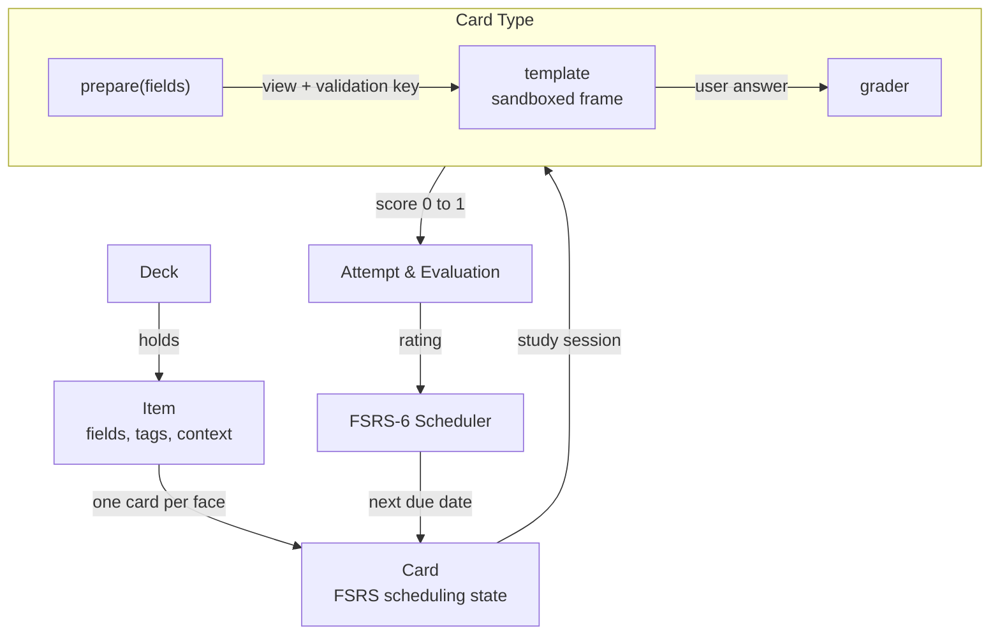

# وِكَاء — Wikae

> **«المذاكرةُ وِكاءُ الحِفْظ»**  
> **وِكَاء — رِباطُ المحفوظ وإتقان المتشابهات**  
> **Wikae — Tie Down & Master Your Memorization**

**منصة متقدمة للتكرار المتباعد وضبط حفظ القرآن الكريم والمتشابهات والحديث الشريف والمتون العلمية.**

In classical Arabic and prophetic tradition, *Al-Wikaa* (الوِكَاء) is the steadfast cord tying the mouth of a vessel to firmly preserve its precious contents from spilling. **Wikae (وِكَاء)** is a modern, self-hosted spaced-repetition platform designed for serious memorizers. Cards go far beyond static text: every card type is an interactive, programmable canvas — from Quranic Mutashabihat with authentic Uthmani script and pivotal blank completion, to Hadith memorization with isnad and grading, cloze deletion, typed recall, and intelligent AI evaluation.

Open-ended answers and recited text are evaluated with intelligent AI grading (supporting Groq, OpenAI, OpenRouter, and local models) that tells you precisely what you remembered and what was missed. Scheduling is powered by the state-of-the-art **FSRS-6** algorithm, paired with revision targets, exam deadlines, and interactive review modes. Every operation in Wikae is accessible through a modern React/Tailwind interface and through the fast `wikae` CLI with structured JSON output.

## Why Wikae

Classic flashcards test superficial recognition: you see the front, think of the back, flip the card and rate yourself. That works for basic vocabulary, but falls short for serious memorization of Quranic verses, Mutashabihat distinctions, Hadith texts, and structured knowledge where precision matters. Wikae keeps what makes spaced repetition scientifically sound and upgrades what a card is.

| | Classic flashcard apps | Wikae |
|---|---|---|
| What a card is | Static front and back | Interactive program: template, script, and grader |
| Who grades it | Self-assessment only | Self, script validation, or AI evaluation with detailed feedback |
| Quranic Mutashabihat | Manual side-by-side comparison | Automatic blanking of distinctive phrasing and contextual Ayah validation |
| Hadith & Texts | Self-grading prone to bias | Exact word-by-word checking and AI verification of meaning and isnad |
| Memorization deadlines | Intervals ignore target dates | Deadlines pull cards in ahead of your Khatm or exam review |
| Automation | Complex add-ons or raw DB edits | Unified CLI commands with clean JSON output for scripts and agents |

## With AI or without it

AI is completely optional. Wikae does not require an account or an internet connection to function; your collection stays on your computer in a local SQLite file.

**Without AI**, Wikae is a fast, offline spaced-repetition app under your full control. Built-in card types are checked locally by deterministic scripts: typed words with tolerance, cloze blanks, multiple choice, ordering, or manual self-rating. Every card type, theme, and scheduling setting is fully customizable.

**With AI**, Wikae provides intelligent evaluation:

- **Instant feedback on your answers.** Quranic recitation, Hadith explanations, and free-text answers get a clear verdict with specific notes on what was omitted or transposed.
- **Packs created from your texts.** Hand an agent your notes, text files, or study material; it generates structured packs, validates them with `wikae pack check`, and imports them.
- **Assistant management.** Through the CLI or in-app assistant, an agent can reorganize decks, identify weak cards, and schedule reviews around upcoming deadlines.

## Card Types in Wikae

Every card type is a self-contained module of HTML, CSS, and JavaScript with dedicated grading logic:

- **Quranic Mutashabihat (`quran-mutashabihat`):** Displays the surrounding context in Uthmani calligraphy, blanks out the pivotal distinctive phrases that distinguish similar verses, and grades typed answers with diacritic tolerance and word-level accuracy.
- **Cloze Deletion (`cloze`):** Hides key words or phrases inside Ayahs, Hadiths, or definitions, allowing focused recall of pivotal terms.
- **Typed Answer (`typed`):** Requires exact spelling and phrasing, checked with fuzzy matching and customizable case/punctuation rules.
- **Multiple Choice (`mcq`):** Multiple-choice questions with randomized option ordering and optional explanations per choice.
- **Match (`match`):** Match terms with their definitions, vocabulary with meanings, or Quranic Surahs with their themes.
- **Order (`order`):** Arrange verses, Hadith narrators in an isnad, or chronological events into the correct sequence.
- **Free Answer (`free`):** Type explanations, rulings, or summaries graded by AI against a rubric and reference answer.
- **Basic (`basic`):** Classical two-sided flashcards with rich markdown and media support.
- **Image Occlusion (`occlusion`):** Conceal parts of diagrams, calligraphy charts, or manuscripts to test visual memorization.
- **Numeric & Math (`numeric`, `math`):** Numerical calculations with tolerances and mathematical equivalence.
- **Code & Drawing (`code`, `draw`):** Syntax-highlighted code execution in a sandbox, and sketch/handwriting input graded by vision models.

## Decks from the Market

Wikae connects to the community catalog to install curated decks and card types in one click:

- **متشابهات سورة البقرة (Mutashabihat of Surat Al-Baqarah):** Interactive cards covering the frequent and subtle Mutashabihat throughout Surat Al-Baqarah.
- **الأربعون النووية (The Forty Hadith of An-Nawawi):** Complete Hadith texts, narrators, and key vocabulary for foundational Islamic memorization.
- **Curated themes:** Clean aesthetic themes including Midnight, Forest, Amber, Sand, and modern dark/light variants designed for comfortable reading of Arabic text.

## Key Features

- **Built for Arabic and Uthmani Typography:** Native RTL support, integrated Amiri Quran and Hafs Uthmani font rendering, and diacritic handling.
- **State-of-the-art FSRS-6 Scheduling:** Modern spaced repetition algorithm predicting memory stability and retrievability, with customizable learning steps, fuzzing, and per-deck daily limits.
- **Pluggable Schedulers:** Choose between FSRS-6, daily `drill` mode (for continuous recitation practice without ratings), Leitner boxes, or custom scripts.
- **Revision Deadlines:** Set a target date (e.g. Ramadan, Khatm, or an exam); Wikae pulls upcoming cards forward so everything is consolidated before the date.
- **Hierarchical Deck Tree:** Drag-and-drop decks and subdecks (`القرآن::البقرة`, `الحديث::الأربعون_النووية`), each inheriting or overriding scheduling presets.
- **Rich Analytics & Retention Statistics:** Track true retention rate, daily review forecast, memory stability curve, and review streaks.
- **High Privacy & Local-first:** SQLite storage (`~/.etude/etude.db`), local media directory, and no telemetry.
- **Comprehensive CLI:** More than 140 commands with structured JSON output, dry-run mode, and machine-readable command schemas.
- **Anki Import:** Import `.apkg` and `.colpkg` collections, retaining deck hierarchies, tags, media, and review history.

## Quick Start

### From Source

Wikae requires Node 24 or newer. Node runs the TypeScript sources directly without a backend build step.

```sh
git clone https://github.com/Zibhelina/etude.git wikae
cd wikae
npm install
npm run build        # builds the web application into web/dist
npm start            # starts the server on http://127.0.0.1:4610
```

Open `http://127.0.0.1:4610` in your browser. Your collection is saved to `~/.etude/etude.db`.

### CLI Usage

```sh
npm link             # makes the `wikae` command available globally

wikae serve          # launch the web server and API
wikae study next     # fetch the next due card
wikae stats overview # display your review statistics and retention
wikae pack import examples/quran-mutashabihat.pack.json # import a pack
```

### Desktop Application

To launch Wikae in a standalone desktop window:

```sh
npm run desktop
```

### Configure AI Grading (Optional)

1. Open **Settings → AI grading** in the web interface.
2. Select your preferred provider (**Groq**, **OpenRouter**, **OpenAI**, or a local Ollama/llama.cpp server).
3. Enter your API key and choose your models (e.g. `llama-3.3-70b-versatile` on Groq).
4. Keys are securely stored in `~/.etude/.env` with strict permissions (`0600`).

You can also set your API key from the terminal:

```sh
printf %s "$GROQ_API_KEY" | wikae settings key set GROQ_API_KEY
```

### Mobile Access

To access Wikae from your phone or tablet on your local network:

```sh
wikae serve --host 0.0.0.0 --token "$(openssl rand -hex 16)"
```

Open `http://<your-computer-ip>:4610/?token=<token>` on your mobile device and tap **Add to Home Screen**.

## Configuration

| Setting | Description |
|---|---|
| `~/.etude/.env` | Secure API keys and environment variables. Never committed or sent to third parties. |
| `--db PATH` or `ETUDE_DB` | Path to the SQLite collection database (default: `~/.etude/etude.db`). |
| `ETUDE_HOME` | Configuration root directory (default: `~/.etude`). |
| `--port` or `ETUDE_PORT` | HTTP port (default: 4610). |
| `--host` or `ETUDE_HOST` | Host address (default: `127.0.0.1`). Non-local addresses require a token. |
| `--token` or `ETUDE_TOKEN` | Bearer token for authentication when exposed beyond localhost. |

## Packs

Packs are JSON files containing decks, card types, settings, and items. Importing is idempotent and preserves your review history.

```json
{
  "etude": "pack/1",
  "name": "Quranic Mutashabihat",
  "decks": [{ "name": "القرآن::المتشابهات", "instructions": "اضبط الآية مع مراعاة الحركات وسياق السورة." }],
  "items": [
    {
      "id": "quran.baqarah.10",
      "type": "quran-mutashabihat",
      "deck": "القرآن::المتشابهات",
      "fields": {
        "surah": "البقرة",
        "verseNumber": 10,
        "verseText": "فِي قُلُوبِهِم مَّرَضٌ فَزَادَهُمُ اللَّهُ مَرَضًا وَلَهُمْ عَذَابٌ أَلِيمٌ بِمَا كَانُوا يَكْذِبُونَ",
        "distinctivePhrase": "بِمَا كَانُوا يَكْذِبُونَ",
        "comparisonContext": "في سورة البقرة: (بِمَا كَانُوا يَكْذِبُونَ)، وقارنها بآيات أخرى."
      }
    }
  ]
}
```

```sh
wikae pack check my-deck.pack.json            # validate deck structure and cards
wikae pack import my-deck.pack.json --dry-run # preview changes without writing
wikae pack import my-deck.pack.json           # import into collection
```

## Architecture

Wikae maintains a clean separation between **what** you memorize (items), **how** it is rendered and evaluated (card types and graders), and **when** it returns (the deck's scheduler):



| Concept | Description |
| --- | --- |
| **Deck** | A node in the hierarchical tree (`القرآن::البقرة`). Holds items and scheduling settings inherited by subdecks. |
| **Preset** | Named configuration profiles (daily limits, target retention, FSRS parameters, schedulers) shared across decks. |
| **Item** | The memorization content: fields, tags, and context. Analogous to a note in Anki. |
| **Card** | An individual study face derived from an item with its own independent FSRS stability, difficulty, and due date. |
| **Card type** | An isolated module defining fields, template HTML, CSS, client-side card interaction, and grading scripts. |
| **Grader** | Computes a score from 0 to 1 (`self`, deterministic `script`, `ai` evaluation, or `hybrid`). |
| **Scheduler** | Determines review intervals (`fsrs` by default, `drill` for unrated practice, or `leitner`). |
| **Pack** | A portable JSON file carrying decks, card types, and items for easy sharing and versioning. |

## Security

Card templates execute in sandboxed iframes with opaque origins. Evaluation scripts execute in an isolated QuickJS WebAssembly environment. The HTTP server binds exclusively to `127.0.0.1` unless an explicit access token is configured.

## License

Wikae is free software licensed under the [GNU Affero General Public License v3.0](LICENSE) (AGPL-3.0).
