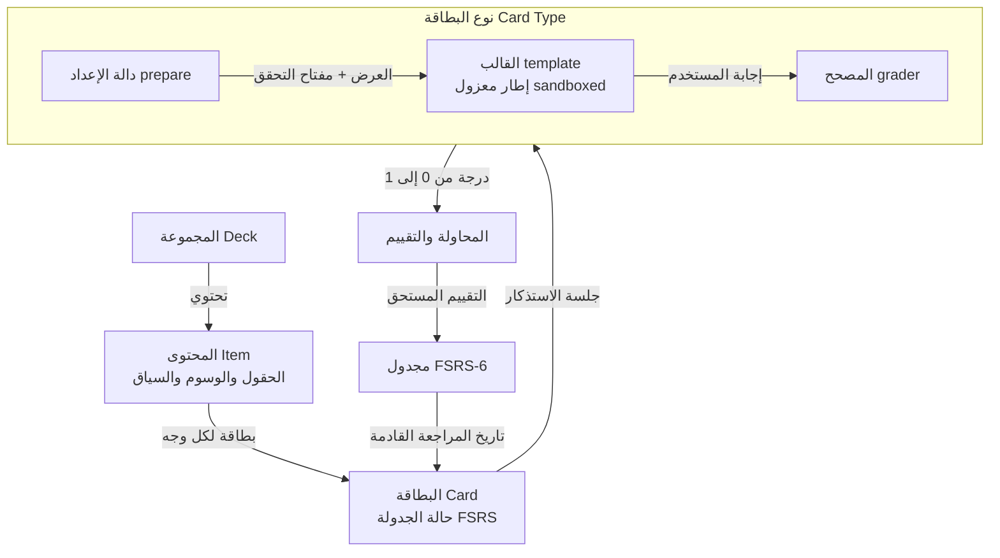

<p align="center">
  
 <h1 align="center">آفَةُ الْعِلْمِ النِّسْيَانُ، وَتَرْكُ الْمُذَاكَرَةِ</h1>
 
 <h3 align="center">
وِكَاء — رِباطُ المحفوظ وإتقان المتشابهات
</h3>
</p>


**منصة متقدمة للتكرار المتباعد وضبط حفظ القرآن الكريم والمتشابهات والحديث الشريف والمتون العلمية.**

في لسان العرب وتراثنا الأصيل: **«الوِكَاء»** هو الخيط أو الرباط المتين الذي تُشدّ به فوهة الوعاء فيحفظ ما بداخله من الضياع والتسرب، كما جاء في الأثر: *«المذاكرةُ وِكاءُ الحِفْظ»*. **منصة وِكَاء (Wikae)** هي منصة حرة ومستقلة للتكرار المتباعد (Spaced Repetition) صُممت خصيصاً لخدمة حفاظ كتاب الله وطلاب العلم الشرعي، لترتقي بالبطاقات التعليمية من نصوص جامدة إلى بيئات برمجية تفاعلية. من ضبط المتشابهات القرآنية بالرسم العثماني وحجب الألفاظ المفصلية، إلى حفظ متون الحديث الشريف بأسانيدها، والاختبارات الفورية الدقيقة المدعومة بنماذج الذكاء الاصطناعي التي تحدد بدقة مواضع الخطأ والسقط في الاستذكار.

تُقيّم الإجابات المفتوحة والتسميع الشفهي والكتابي عبر مصحح ذكي (يدعم Groq وOpenAI وOpenRouter والنماذج المحلية) يوضح لك بالتفصيل ما تم استحضاره بنجاح وما سقط منك أثناء الاسترجاع. وتعتمد المنصة خوارزمية **FSRS-6** الحديثة لتحديد مواعيد التكرار بدقة علمية، مع إمكانية ربط الجداول بمواعيد الختمات والاختبارات الدورية. تتوفر المنصة عبر واجهة عصرية وسريعة مبنية بتقنيات React وTailwind، بالإضافة إلى أداة سطر أوامر `wikae` السريعة بمخرجات JSON مهيكلة.

## لماذا وِكَاء؟

تعتمد تطبيقات البطاقات التقليدية على مجرد التعرف الظاهري: تنظر إلى وجه البطاقة، وتتذكر ظهرها، ثم تقلبها وتقيّم نفسك بنفسك. هذا الأسلوب قد يفيد في حفظ المفردات البسيطة، ولكنه يعجز أمام المتطلبات الدقيقة لحفظ القرآن الكريم وتفريق المتشابهات اللفظية، وضبط متون الحديث والأسانيد. تُحافظ منصة وِكَاء على الأسس العلمية للتكرار المتباعد وترتقي بمفهوم البطاقة إلى مستوى الإتقان العملي.

| المعيار | تطبيقات البطاقات التقليدية | منصة وِكَاء (Wikae) |
|---|---|---|
| **مفهوم البطاقة** | وجه وظهر ثابتان لا يتغيران | برنامج تفاعلي مستقل: قالب مرئي، ومنطق برمجي، ونظام تحقق آلي |
| **آلية التصحيح** | تقييم ذاتي يحتمل الخطأ والتساهل | تحقق برمجي صارم أو تصحيح ذكي يبرز الألفاظ الناقصة والزائدة |
| **المتشابهات القرآنية** | مقارنة يدوية بين آيتين | طمس الكلمات المفصلية في سياق الآية بالرسم العثماني مع المقارنة الفورية |
| **الحديث والمتون** | قراءة تقليدية غير مفصلة | فحص تطابق الألفاظ كلمة بكلمة والتأكد من سلامة السند والرواية |
| **مواعيد الختمة والاختبار** | فترات تكرار آلية تتجاهل أهدافك | تحديد تاريخ الختمة أو الاختبار ليقوم النظام بجدولة الحفظ وضغط المراجعة قبله |
| **الأتمتة والربط** | إضافات معقدة أو تعديل يدوي للقواعد | سطر أوامر كامل وموحد بمخرجات JSON يسهل دمجه مع البرمجيات والمساعدين |

## مع الذكاء الاصطناعي أو بدونه

الذكاء الاصطناعي في منصة وِكَاء ميزة إضافية واختيارية بالكامل؛ فالمنصة لا تشترط إنشاء حساب أو الاتصال بالإنترنت، وتبقى بياناتك محفوظة بالكامل على جهازك في قاعدة بيانات SQLite محلية.

**بدون الذكاء الاصطناعي**: تعمل وِكَاء كمنصة تكرار متباعد سريعة ومحلية بإشرافك التام. يتم تصحيح معظم أنواع البطاقات برمجياً عبر دوال محلية سريعة: المطابقة النصية المرنة، حجب الألفاظ المفصلية، أسئلة الاختيار من متعدد، ترتيب الجمل والآيات، أو التقييم الذاتي المباشر. كما يمكنك تخصيص كافة القوالب والسمات وخوارزميات الجدولة بحرية تامة.

**مع تفعيل الذكاء الاصطناعي**: ترتقي المنصة بقدراتك في الحفظ والضبط:
- **تحليل فوري لإجاباتك وتسميعك**: يحلل النموذج تسميعك للآيات أو شرحك للأحاديث، ويعطيك تقييماً دقيقاً مع جمل توضيحية لما تم إغفاله أو تقديمه وتأخيره.
- **توليد حزم تعليمية من كتبك ومذكراتك**: يمكنك تزويد المساعد الآلي بنصوص المتون أو المقررات ليقوم بإنشاء حزم وبطاقات مهيكلة، والتحقق منها عبر أمر `wikae pack check` ثم استيرادها.
- **إدارة ذكية لمجموعاتك**: عبر سطر الأوامر أو المساعد الداخلي، يمكن للنظام ترتيب شجرة المجموعات، واستخراج البطاقات التي يتكرر تعثرك فيها، وإعادة ضبط المواعيد وفق جدول مراجعتك.

## أنواع البطاقات في وِكَاء

صُمم كل نوع من البطاقات كوحدة برمجية قائمة بذاتها تضم HTML وCSS وJavaScript مع معايير تصحيح مستقلة:

- **متشابهات القرآن الكريم (`quran-mutashabihat`)**: تعرض الآية الكريمة بالرسم العثماني المعتمد، وتطمس الألفاظ المفصلية التي تميز الآية عن نظيراتها في السور الأخرى، مع تصحيح ذكي يراعي الحركات والأحرف المتشابهة.
- **ملء الفراغات (`cloze`)**: حجب كلمات أو عبارات محددة داخل الآية أو متن الحديث لاختبار استحضار اللفظ الصحيح في موضعه.
- **الإجابة المكتوبة (`typed`)**: تتطلب كتابة النص بدقة لاختبار الحفظ الكتابي والإملائي مع خيارات للتسامح البرمجي مع الفواصل والهمزات.
- **الاختيار من متعدد (`mcq`)**: أسئلة باختيارات متعددة مع ترتيب عشوائي للخيارات وتوضيح سبب صحة أو خطأ كل خيار.
- **المطابقة (`match`)**: مطابقة المفردات الغريبة بمعانيها، أو ربط الآيات بموضوعاتها، أو ربط الأحاديث برواتها.
- **الترتيب (`order`)**: ترتيب الآيات وفق تسلسلها في السورة، أو ترتيب رواة الأسانيد، أو الوقائع التاريخية في السيرة النبوية.
- **الإجابة المفتوحة (`free`)**: كتابة تفسير، أو استنباط حكم، أو إيراد شرح يُصحح ذكياً وفق نموذج إجابة ومعايير معتمدة.
- **البطاقة الأساسية (`basic`)**: بطاقة تقليدية ذات وجهين تدعم تنسيق النصوص المتقدم، والصور، والمقاطع الصوتية.
- **حجب الصور والمخطوطات (`occlusion`)**: إخفاء أجزاء محددة من لوحات التجويد، أو شجرات الأسانيد، أو صفحات المصحف لاختبار الذاكرة البصرية.
- **الحساب والرياضيات (`numeric`, `math`)**: بطاقات حساب مسائل المواريث والفرائض مع تدقيق رياضي متقدم.
- **الرسم والأكواد (`draw`, `code`)**: التخطيط والرسم اليدوي، وكتابة الأكواد مع تنفيذها وفحصها داخل بيئة معزولة وآمنة.

## حزم المتجر المعتمدة

ترتبط منصة وِكَاء بمتجر حزم مفتوح المصدر يتيح تحميل وتثبيت الحزم الإسلامية بضغطة زر واحدة:

- **متشابهات سورة البقرة (Mutashabihat of Surat Al-Baqarah)**: بطاقات تفاعلية تغطي كافة المواضع المتشابهة في سورة البقرة وتمييزها عن باقي سور المصحف الشريف.
- **الأربعون النووية (The Forty Hadith of An-Nawawi)**: متون الأحاديث النبوية كاملة مع الأسانيد، وتراجم الرواة، والمفردات اللغوية الهامة.
- **سمات ومظاهر بصرية راقية**: سمات مريحة للقراءة والمذاكرة المطولة (مثل Midnight وForest وAmber وSand) مع ضبط الخطوط العربية الكلاسيكية.

## أبرز المزايا

- **عناية فائقة بالخط العربي والرسم العثماني**: دعم كامل لاتجاه الكتابة من اليمين إلى اليسار (RTL) مع خطوط مصحف المدينة النبوية، والخط الأميري، وخطوط الرقعة والنسخ.
- **خوارزمية الجدولة FSRS-6**: أحدث خوارزمية تكرار متباعد علمية تتنبأ بمستوى استقرار المعلومة في الذاكرة ومعدل النسيان، مع دعم تخصيص معدل الاستبقاء اليومي.
- **أنظمة جدولة متعددة**: إمكانية التبديل بين خوارزمية FSRS، ونمط التدريب اليومي المستمر (`drill`) دون تقييم، ونظام صناديق لايتنر، أو كتابة مجدول خاص بك.
- **مواعيد الختمات والمراجعات**: إمكانية تعيين تاريخ مستهدف (مثل شهر رمضان، أو موعد اختبار حفظ)؛ لتقوم المنصة بسحب البطاقات وجدولتها لتثبيت المحفوظ قبل حلول الموعد.
- **شجرة مجموعات هرمية مرنة**: تنظيم هرمي للمجموعات والمجلدات (مثل `القرآن::البقرة` أو `الحديث::الأربعون_النووية`) مع وراثة الإعدادات وتخصيصها لكل مستوى.
- **لوحة إحصائيات بيانية متكاملة**: قياس نسبة الاستبقاء الحقيقية، والتنبؤ بعدد المراجعات القادمة، ومخطط منحنى النسيان، ومتابعة سلاسل الاستمرار اليومية (Streak).
- **أقصى درجات الخصوصية والاستقلالية**: قاعدة بيانات محلية واحدة بصيغة SQLite داخل جهازك (`~/.etude/etude.db`) مع مجلد وسائط محلي دون أي تتبع خارجي.
- **سطر أوامر متكامل**: أكثر من 140 أمراً عبر أداة `wikae` بمخرجات JSON دقيقة تدعم المعاينة قبل التطبيق (`--dry-run`).
- **استيراد مجموعات Anki**: استيراد سلس لحزم `.apkg` و `.colpkg` مع نقل المجموعات، والوسوم، والوسائط، وسجل المراجعات بالكامل.

## دليل البدء السريع

### التثبيت من المصدر

تتطلب منصة وِكَاء بيئة Node.js الإصدار 24 أو أحدث؛ حيث يقوم Node بتشغيل كود TypeScript مباشرة دون الحاجة لمرحلة بناء خلفية.

```sh
git clone https://github.com/Sidali-Djeghbal/wikae.git wikae
cd wikae
npm install
npm run build        # بناء واجهة الويب داخل مجلد web/dist
npm start            # تشغيل الخادم على الرابط http://127.0.0.1:4610
```

افتح الرابط `http://127.0.0.1:4610` في متصفحك. تُحفظ مجموعتك وبياناتك في الملف `~/.etude/etude.db`.

### استخدام سطر الأوامر (CLI)

```sh
npm link             # تثبيت أمر wikae في بيئة النظام العامة

wikae serve          # تشغيل خادم المنصة وواجهة البرمجة (API)
wikae study next     # جلب البطاقة التالية المستحقة للمراجعة
wikae stats overview # عرض الإحصائيات العامة ونسبة الاستبقاء
wikae pack import examples/quran-mutashabihat.pack.json # استيراد حزمة بطاقات
```

### تطبيق سطح المكتب

لتشغيل وِكَاء كتطبيق مستقل على سطح المكتب:

```sh
npm run desktop
```

### تفعيل التصحيح بالذكاء الاصطناعي (اختياري)

1. افتح صفحة **الإعدادات ← تصحيح الذكاء الاصطناعي** في واجهة المنصة.
2. اختر المزود المفضل لديك (**Groq**، أو **OpenRouter**، أو **OpenAI**، أو خادم محلي مثل Ollama أو llama.cpp).
3. أدخل مفتاح واجهة البرمجة (API Key) وحدد النموذج المطلوب (مثل `llama-3.3-70b-versatile` على منصة Groq).
4. تُحفظ المفاتيح في ملف محلي مشفر الصلاحيات `~/.etude/.env` بصلاحية مقيدة (`0600`) ولا تغادر جهازك إلا إلى المزود المختار مباشرة.

يمكنك أيضاً ضبط المفتاح من الطرفية مباشرة:

```sh
printf %s "$GROQ_API_KEY" | wikae settings key set GROQ_API_KEY
```

### استخدام المنصة من الهاتف المحمول

لفتح المنصة واستخدامها من هاتفك أو جهازك اللوحي عبر الشبكة المحلية نفسها:

```sh
wikae serve --host 0.0.0.0 --token "$(openssl rand -hex 16)"
```

افتح الرابط `http://<عنوان-حاسوبك-المحلي>:4610/?token=<الرمز>` من متصفح الهاتف، ثم اختر **إضافة إلى الشاشة الرئيسية** لتثبيتها كتطبيق مباشر.

## التهيئة وخيارات التشغيل

| الإعداد | الوصف |
|---|---|
| `~/.etude/.env` | ملف المفاتيح السرية والمتغيرات البيئية؛ لا يُرفع للمستودع ولا يُشارك مطلقاً. |
| `--db PATH` أو `ETUDE_DB` | مسار ملف قاعدة بيانات SQLite (الافتراضي: `~/.etude/etude.db`). |
| `ETUDE_HOME` | المجلد الرئيسي للتهيئة وقاعدة البيانات (الافتراضي: `~/.etude`). |
| `--port` أو `ETUDE_PORT` | منفذ تشغيل الخادم (الافتراضي: 4610). |
| `--host` أو `ETUDE_HOST` | عنوان الاستماع (الافتراضي: `127.0.0.1`؛ وأي عنوان خارجي يشترط رمز تحقق). |
| `--token` أو `ETUDE_TOKEN` | رمز التحقق المطلوب في ترويسة الطلب أو الرابط عند تشغيل الخادم خارج localhost. |

## حزم البطاقات (Packs)

تُحفظ حزم البطاقات في ملف JSON واحد يضم المجموعات، وأنواع البطاقات، والإعدادات، والبطاقات؛ واستيراد الحزمة عملية آمنة لا تُكرر البيانات وتُحافظ على سجل مراجعاتك السابقة.

```json
{
  "etude": "pack/1",
  "name": "Quranic Mutashabihat",
  "decks": [{ "name": "القرآن::المتشابهات", "instructions": "اضبط الآية مع مراعاة الحركات وسياق السورة." }],
  "items": [
    {
      "id": "quran.baqarah.10",
      "type": "quran-mutashabihat",
      "deck": "القرآن::المتشابهات",
      "fields": {
        "surah": "البقرة",
        "verseNumber": 10,
        "verseText": "فِي قُلُوبِهِم مَّرَضٌ فَزَادَهُمُ اللَّهُ مَرَضًا وَلَهُمْ عَذَابٌ أَلِيمٌ بِمَا كَانُوا يَكْذِبُونَ",
        "distinctivePhrase": "بِمَا كَانُوا يَكْذِبُونَ",
        "comparisonContext": "في سورة البقرة: (بِمَا كَانُوا يَكْذِبُونَ)، وقارنها بسائر المواضع."
      }
    }
  ]
}
```

```sh
wikae pack check my-deck.pack.json            # التحقق من صحة بناء الحزمة وبطاقاتها
wikae pack import my-deck.pack.json --dry-run # معاينة التغييرات دون كتابتها
wikae pack import my-deck.pack.json           # استيراد الحزمة إلى مجموعتك
```

## البنية المعمارية للنظام

تفصل منصة وِكَاء بشكل كامل ومستقل بين **محتوى المحفوظ** (العنصر/Item)، و**طريقة عرضه وتصحيحه** (نوع البطاقة/Card Type والمصحح/Grader)، و**موعد استحقاق مراجعته** (المجدول/Scheduler):



| المفهوم | المعنى والوظيفة |
|---|---|
| **المجموعة (Deck)** | عقدة في الشجرة الهرمية (مثل `القرآن::البقرة`)؛ تحتوي البطاقات وإعدادات الجدولة التي ترثها المجموعات الفرعية. |
| **الملف الإعدادي (Preset)** | نمط إعدادات مسمى (الحدود اليومية، نسبة الاستبقاء المستهدفة، معلمات FSRS) تشترك فيه مجموعات متعددة. |
| **المحتوى (Item)** | المادة العلمية المراد حفظها: الحقول النصية، والوسوم، والبيانات التوضيحية (يقابل Note في Anki). |
| **البطاقة (Card)** | الوجه الفعلي الذي يظهر في جلسة المراجعة، ويحتفظ بحالة الجدولة ومستوى الاستقرار والاستحقاق بشكل مستقل. |
| **نوع البطاقة (Card Type)** | الوحدة البرمجية المسؤولة عن شكل البطاقة وتصميمها (HTML/CSS) ومنطق التفاعل والتحضير. |
| **المصحح (Grader)** | محرك احتساب النتيجة من 0 إلى 1 (تصحيح ذاتي، أو كود برمجي محلي، أو تقييم ذكي بالذكاء الاصطناعي). |
| **المجدول (Scheduler)** | المحرك الذي يحدد تاريخ المراجعة القادم (FSRS-6 افتراضياً، أو التدريب المتكرر drill، أو لايتنر). |
| **الحزمة (Pack)** | ملف JSON يحمل المجموعات، والأنواع، والمحتويات لمشاركتها وتداولها بسهولة. |

## الأمان والحماية

تعمل قوالب البطاقات التفاعلية داخل أطر `iframe` معزولة ومحرومة من الوصول إلى الذاكرة الرئيسية أو الشبكة. وتُنفذ أكواد التحضير والتصحيح داخل بيئة QuickJS المعزولة عبر تقنية WebAssembly على الخادم. كما يقتصر خادم HTTP افتراضياً على الاستماع لعنوان الجهاز المحلي `127.0.0.1` ولا يمكن الوصول إليه عن بُعد إلا عبر رمز مصادقة مشفر يتم توليده خصيصاً.

## شكر وتقدير للمشاريع مفتوحة المصدر (Credits & Acknowledgments)

تعتز منصة **وِكَاء (Wikae)** بكونها امتداداً وتطويراً لمجتمع البرمجيات الحرة المفتوحة، وتدين بالفضل والتقدير للجهود والمشاريع التقنية الرائدة التي بُنيت المنصة بالاعتماد عليها:

- **مشروع Étude**: المنصة الأصلية الرائدة التي طوّرها المهندس [João Henrique Costa Araujo](https://github.com/jhca) بمستودع [Zibhelina/etude](https://github.com/Zibhelina/etude) بموجب ترخيص AGPL-3.0، والتي وفّرت النواة البرمجية والهندسة المبتكرة لتشغيل البطاقات البرمجية التفاعلية والتكامل مع سطر الأوامر.
- **خوارزمية FSRS (Free Spaced Repetition Scheduler)**: الخوارزمية العلمية الحديثة لتوقع النسيان ومعدل الاستقرار، ومكتبة [ts-fsrs](https://github.com/open-spaced-repetition/ts-fsrs) من مجتمع [Open Spaced Repetition](https://github.com/open-spaced-repetition).
- **محرك QuickJS ومكتبة quickjs-emscripten**: لتمكين تنفيذ أكواد التحضير والتصحيح للبطاقات داخل بيئة WebAssembly معزولة وآمنة بالكامل.
- **قاعدة بيانات SQLite وsqlite-wasm**: محرك البيانات المحلي فائق السرعة والموثوقية لتخزين المجموعات والبطاقات وسجلات المراجعة.
- **إطار Hono**: إطار خادم الويب الخفيف لتوفير واجهات البرمجة (API) وخدمة إطارات البطاقات.
- **مجمع الملك فهد لطباعة المصحف الشريف والخطوط العربية**: لتوفير الخطوط العثمانية المتقنة والمصاحف التي يعتمد عليها عرض الآيات والمتشابهات بالرسم العثماني، بالإضافة إلى خطوط Amiri وAref Ruqaa.

### منظومة مشاريع وِكَاء

- **[Wikae Core](https://github.com/Sidali-Djeghbal/wikae)**: المستودع الرئيسي الذي يضم المنصة، وأداة سطر الأوامر، وتطبيق الويب، وتطبيق سطح المكتب.
- **[Wikae Market](https://github.com/Sidali-Djeghbal/wikae-market)**: المستودع المفتوح لحزم وبطاقات القرآن الكريم، والمتشابهات، والحديث الشريف، والسمات البصرية.
- **[Wikae Web](https://sidali-djeghbal.github.io/wikae/)**: البوابة التعريفية وموقع المشروع الرسمي عبر GitHub Pages.

## الترخيص البرمجي

منصة وِكَاء برمجية حرة ومفتوحة المصدر خاضعة لـ [رخصة جنو أفيرو العمومية الإصدار 3.0](LICENSE) (AGPL-3.0).
